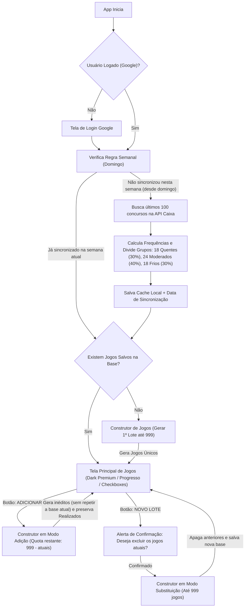

# Plano de Implementação Atualizado: Mega-Sena Smart (Flutter - iOS & Android)

## 1. Visão Geral e Fluxo Completo do Usuário

---

## 2. Regras de Negócio Consolidadas

### 2.1 Autenticação e Armazenamento Local
- **Login Exclusivo Google (`google_sign_in`):** Autenticação rápida com conta Google (e fallback de desenvolvimento local enquanto chaves SHA-1 / OAuth nativas não estiverem configuradas).
- **Persistência 100% Local (`shared_preferences`):**
  - Perfil do usuário autenticado.
  - Estatísticas dos últimos 100 concursos e data da última sincronização semanal.
  - Base única ativa de jogos gerados e status individual (`isCompleted: true/false`) de cada jogo.

### 2.2 Sincronização Semanal (Base: Domingo)
- **Janela Semanal:** Calculada a partir do domingo mais recente (`00:00:00`) em [`LotterySyncService.shouldSyncForCurrentWeek`](file:///home/s630589102/wrk-kiro/wrk-antigravity/mega-sena/lib/services/lottery_sync_service.dart#L36-L43).
- Se o usuário já sincronizou no domingo atual (ou durante a semana corrente), novos logins na segunda-feira até sábado reutilizam a base salva sem nova requisição. A nova sincronização só ocorre a partir do próximo domingo.
- **Fonte:** API Oficial das Loterias Caixa (`servicebus2.caixa.gov.br/portaldeloterias/api/megasena`) com fallback automático para API espelho e semente histórica offline.

### 2.3 Classificação das 60 Dezenas (30% / 40% / 30%)
Com base nos últimos 100 concursos sincronizados em [`FrequencyStats.fromDraws`](file:///home/s630589102/wrk-kiro/wrk-antigravity/mega-sena/lib/models/frequency_stats.dart#L41-L88):
1. Conta-se a frequência de aparição de cada dezena (`01` a `60`).
2. Ordena-se da maior para a menor frequência (com desempate determinístico pelo concurso mais recente em que a dezena saiu e, em seguida, pelo menor número da dezena).
3. Separação exata:
   - **Mais Sorteados (`q` - 30%):** 18 dezenas (1ª à 18ª).
   - **Moderados (`m` - 40%):** 24 dezenas (19ª à 42ª).
   - **Menos Sorteados (`b` - 30%):** 18 dezenas (43ª à 60ª).

### 2.4 Matriz Oficial de Distribuição por Jogo (6 a 20 Dezenas)
Configurada em [`GameGeneratorService.distributionTable`](file:///home/s630589102/wrk-kiro/wrk-antigravity/mega-sena/lib/services/game_generator_service.dart#L15-L31):

| Dezenas no Jogo | Mais Sorteados (`q`) | Moderados (`m`) | Menos Sorteados (`b`) | Total |
| :---: | :---: | :---: | :---: | :---: |
| **6** | 3 | 2 | 1 | 6 |
| **7** | 4 | 2 | 1 | 7 |
| **8** | 4 | 3 | 1 | 8 |
| **9** | 4 | 4 | 1 | 9 |
| **10** | 4 | 4 | 2 | 10 |
| **11** | 5 | 4 | 2 | 11 |
| **12** | 6 | 4 | 2 | 12 |
| **13** | 6 | 5 | 2 | 13 |
| **14** | 6 | 5 | 3 | 14 |
| **15** | 7 | 5 | 3 | 15 |
| **16** | 7 | 6 | 3 | 16 |
| **17** | 8 | 6 | 3 | 17 |
| **18** | 8 | 7 | 3 | 18 |
| **19** | 8 | 7 | 4 | 19 |
| **20** | 9 | 7 | 4 | 20 |

### 2.5 Duas Modalidades de Geração e Limite Global de 999 Jogos

> [!IMPORTANT]
> O limite máximo global na base é de **999 jogos**. Tanto na criação de um lote novo quanto na adição de jogos extras, o sistema garante que **nenhum jogo gerado tenha a mesma combinação de dezenas**.

1. **Modo 1 — Adicionar Jogos aos Atuais (`ADICIONAR JOGOS`):**
   - Mantém todos os jogos já criados na base, **independentemente de quantos estejam marcados como realizados ou pendentes**.
   - Calcula automaticamente a cota restante disponível: `999 - quantidade_atual`.
   - Carrega todas as assinaturas (`combinationKey`) dos jogos já presentes na base antes do sorteio em [`GameGeneratorService.generateBatch`](file:///home/s630589102/wrk-kiro/wrk-antigravity/mega-sena/lib/services/game_generator_service.dart#L45-L78), garantindo que **nenhum jogo novo repita qualquer jogo já existente**.
   - Continua a numeração sequencial dos cartões a partir do último número existente (`#021`, `#022`...).

2. **Modo 2 — Novo Lote Substituindo Atuais (`NOVO LOTE`):**
   - Exibe uma **mensagem de confirmação** detalhando quantos jogos ativos (realizados e pendentes) serão perdidos.
   - Se confirmado pelo usuário, apaga integralmente a lista anterior e gera um novo combinado do zero (`#001` até o total solicitado, limitado a `999`).

---

## 3. Experiência Visual e Componentes (Dark Premium Esmeralda / Neon)

- **[`AppTheme`](file:///home/s630589102/wrk-kiro/wrk-antigravity/mega-sena/lib/theme/app_theme.dart):** Tema Dark profundo com acentos em Verde Esmeralda Neon (`#00E676`), Dourado (`#FBBF24`) para dezenas quentes e Ciano (`#38BDF8`) para dezenas menos sorteadas.
- **[`StatsBannerCard`](file:///home/s630589102/wrk-kiro/wrk-antigravity/mega-sena/lib/widgets/stats_banner_card.dart):** Exibe no topo o resumo da base semanal sincronizada, data da próxima sincronização (próximo domingo) e atalho para inspecionar as 60 dezenas separadas em 30% / 40% / 30%.
- **[`ProgressHeader`](file:///home/s630589102/wrk-kiro/wrk-antigravity/mega-sena/lib/widgets/progress_header.dart):** Barra de progresso animada indicando quantos jogos já foram marcados como realizados e quantos faltam registrar.
- **[`GameCard`](file:///home/s630589102/wrk-kiro/wrk-antigravity/mega-sena/lib/widgets/game_card.dart):** Card interativo com esferas numeradas em ordem crescente, indicador da matriz (`Q•M•B`) e botão/checkbox **MARCAR / REALIZADO**.
- **[`GeneratorSheet`](file:///home/s630589102/wrk-kiro/wrk-antigravity/mega-sena/lib/screens/generator_sheet.dart):** Painel inteligente multi-linha (permite pedir várias quantidades e dezenas ao mesmo tempo) que adapta seus textos, limites e validações conforme é aberto em **Modo Adição** ou **Modo Substituição**.

---

## 4. Estrutura do Projeto e Testes

- [pubspec.yaml](file:///home/s630589102/wrk-kiro/wrk-antigravity/mega-sena/pubspec.yaml) — Configuração de dependências (`google_sign_in`, `shared_preferences`, `http`).
- [lib/main.dart](file:///home/s630589102/wrk-kiro/wrk-antigravity/mega-sena/lib/main.dart) — Inicialização e roteamento de sessão.
- [lib/models/](file:///home/s630589102/wrk-kiro/wrk-antigravity/mega-sena/lib/models/frequency_stats.dart) — Modelos de sorteio, estatísticas 30/40/30, jogos e lotes.
- [lib/services/](file:///home/s630589102/wrk-kiro/wrk-antigravity/mega-sena/lib/services/game_generator_service.dart) — Serviços de autenticação Google, sincronização semanal da Caixa, gerador com trava anti-repetição e persistência local.
- [lib/screens/](file:///home/s630589102/wrk-kiro/wrk-antigravity/mega-sena/lib/screens/home_screen.dart) — Telas de Login, Home e Construtor de Lotes (Novo/Adicionar).
- [test/mega_sena_rules_test.dart](file:///home/s630589102/wrk-kiro/wrk-antigravity/mega-sena/test/mega_sena_rules_test.dart) — Suíte de testes unitários validando a regra do domingo, a divisão 18/24/18, a matriz de 6 a 20 dezenas, o limite de 999 jogos e a adição sem repetição com a base existente.
